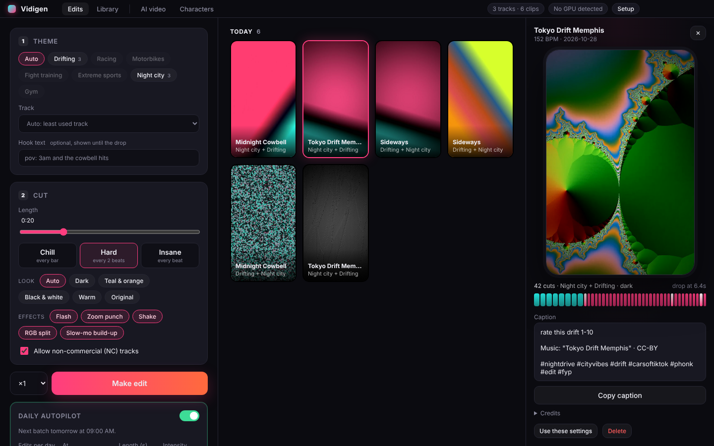
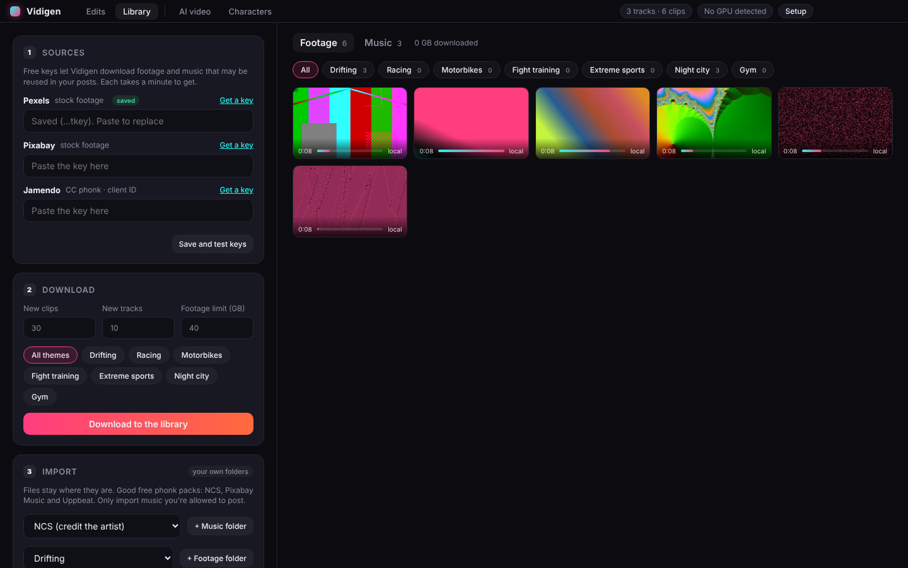
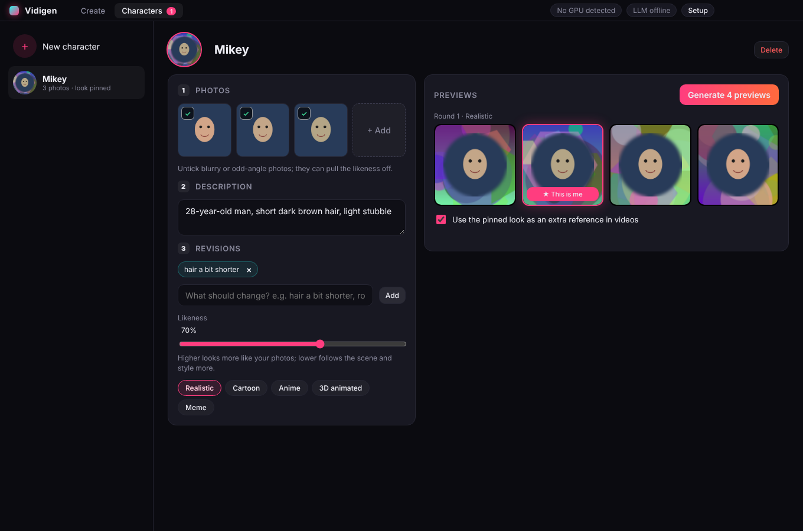
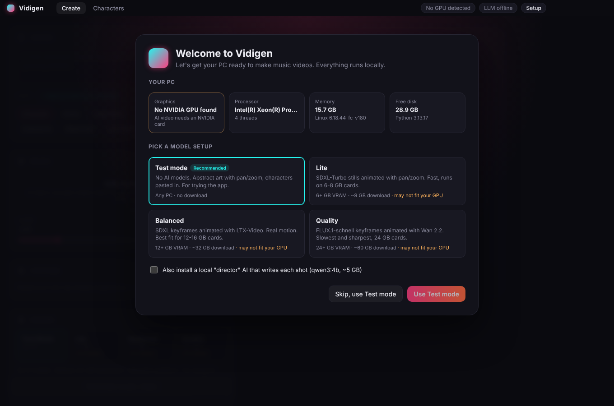

# Vidigen

A Windows desktop app that makes TikTok phonk edits on autopilot: high-adrenaline stock footage (drifting, racing, motorbikes, fight training, extreme sports, night drives) cut to the beat of phonk tracks you're allowed to use. Every day it can top up its library and make a fresh batch of 9:16 edits, ready to post.

It also has an AI video mode that generates a music video from a prompt with local image and video models, including characters that look like you.



## Phonk edits

1. **Library.** Vidigen keeps a local library of phonk tracks and action footage. Each track is analysed once for tempo, beats and the drop; each clip gets a motion profile (how much the picture changes every half second), so edits use the most dynamic moments.
2. **Sources.** With free API keys it downloads footage from [Pexels](https://www.pexels.com/api/) and [Pixabay](https://pixabay.com/api/docs/), and Creative Commons phonk from [Jamendo](https://devportal.jamendo.com/). It searches theme by theme and remembers where it stopped, so every download brings new clips. You can also import folders you already have (NCS, Pixabay Music or Uppbeat packs, your own footage); imported files stay where they are.
3. **The edit.** An edit opens a couple of bars before the drop with slow-motion shots and a slow push-in, then hits the drop with a white flash, zoom punch, shake and RGB split, and cuts every beat or two after it (Chill cuts every bar, Insane every beat). Each cut lands on a detected beat. Looks: dark, teal and orange, black and white, warm, or the original colours. Optional hook text sits on top until the drop.
4. **Output.** 1080×1920, 30 fps H.264 with the track under it, a thumbnail, and a caption with the music credit and hashtags for the theme.
5. **Autopilot.** Once a day (09:00 by default) it downloads new clips and tracks, then makes a batch of edits, rotating themes and favouring tracks and clips it hasn't used lately. Turn on **Run even when Vidigen is closed** and it registers itself with Windows Task Scheduler, which also catches up after the PC was off at that time.



### API keys

All three are free and take a minute. Paste them on the **Library** tab; **Save and test keys** checks each one.

- **Pexels:** sign up, then [request an API key](https://www.pexels.com/api/).
- **Pixabay:** sign up; your key is on the [API docs page](https://pixabay.com/api/docs/).
- **Jamendo:** create an app on the [developer portal](https://devportal.jamendo.com/) and copy its client ID.

Keys are stored in `keys.json` in Vidigen's data folder (`%LOCALAPPDATA%\Vidigen`) and only sent to their own service.

### What you can post

- **Footage** from Pexels and Pixabay is free to use without credit. Their licences forbid selling the clips unchanged and showing identifiable people in a bad light; an edit is fine.
- **Music from Jamendo** is Creative Commons. Vidigen skips "no derivatives" (ND) tracks, because Creative Commons counts syncing music to video as an adaptation. Every caption credits the artist, as BY licences require. Tracks marked **NC** are for non-commercial use only: fine on a personal account, not in paid promotions. Switch off **Allow non-commercial tracks** if your account is monetised.
- **Imported music:** pick its licence when you import (NCS, Pixabay, CC0, CC BY and so on). Only import music you're allowed to post. TikTok's own audio matching can still flag a licensed track now and then; keep the caption credit, which helps if you need to dispute a claim.
- Copyrighted sources such as YouTube rips, Spotify tracks or UFC and F1 broadcast highlights are not supported.

## AI video

Only the vision prompt is required. Without a song, cuts follow a beat grid at the tempo you choose and the video is exported silent, ready for a sound picked inside TikTok. Your own footage is optional too (video-to-video), and so is the cast.

1. **Beat analysis.** The song is decoded with ffmpeg, then a numpy beat tracker (spectral-flux onsets, autocorrelation tempo, dynamic-programming beats) finds tempo, beats, downbeats and a loudness curve.
2. **Shot planning.** Cuts land on beats. A local LLM via [Ollama](https://ollama.com) writes a prompt and camera move for each shot from your concept and style, with a template planner as the fallback.
3. **Keyframes and motion.** A text-to-image model renders one still per shot (conditioned on a character's face photos when the shot features one), and an image-to-video model animates it.
4. **Edit and mix.** ffmpeg fits every clip to 1080×1920 at 30 fps and its beat-synced length, cuts them together and lays the song under it.


### Characters



On the **Characters** tab, upload 3–6 photos of yourself (or of someone who has agreed to it) and confirm you have the right to use the likeness. Vidigen crops each face and uses the crops as references. Then tune the character:

- **Generate previews**: four portraits from the current settings.
- **Revisions**: notes such as "hair a bit shorter" that are added to the description for the next round.
- **Likeness**: how strongly the photos steer the face versus the scene and style.
- **Style**: realistic, cartoon, anime, 3D animated or meme.
- **Pin a preview** ("This is me"): it becomes the avatar and, optionally, an extra reference.
- Untick photos that pull the likeness off.

On the **Create** tab, pick characters in the **Cast** row under the vision prompt. Each shot features one cast member, framed medium or closer so the face carries.

### Presets

| Preset | VRAM | Keyframes | Motion | Download |
|---|---|---|---|---|
| Test mode | none | procedural art, face pasted in | ffmpeg pan/zoom | none |
| Lite | 6 GB+ | SDXL-Turbo + IP-Adapter face | ffmpeg pan/zoom | ~9 GB |
| Balanced | 12 GB+ | SDXL 1.0 + IP-Adapter face | LTX-Video 0.9.7 distilled | ~32 GB |
| Quality | 24 GB+ | FLUX.1-schnell + XLabs IP-Adapter | Wan 2.2 TI2V-5B | ~60 GB |

The Welcome screen recommends a preset from the detected GPU (an RTX 5080 with 16 GB gets **Balanced**). You can switch presets per render once they're installed.

### Song rights

If you add a song, you can note its licence (your own work, CC0, public domain, CC BY / BY-SA, or a licence you hold) and the title and artist. That credit goes into the video metadata and the suggested caption. Vidigen can't check copyright for you and never blocks a render; CC BY songs just get a reminder to add the credit. Good sources: [Free Music Archive](https://freemusicarchive.org), [ccMixter](https://ccmixter.org), [Pixabay Music](https://pixabay.com/music/), [Musopen](https://musopen.org).

## Setup (Windows)



Requirements: Windows 10/11 and Node.js 22. An NVIDIA GPU is needed for the AI presets.

```powershell
git clone https://github.com/michaelbudko/vidigen
cd vidigen\app
npm install
npm run dev
```

Phonk edits work straight away: Python and the engine install themselves on first launch, and ffmpeg is bundled. The **Welcome** screen sets up the AI video mode when you first open that tab:

1. **Python.** It finds Python 3.10+ (skipping the Microsoft Store stub). If there isn't one, **Install Python for me** installs Python 3.12 with winget.
2. **Engine.** It creates a private environment and installs the engine. ffmpeg comes bundled, so nothing else is needed.
3. **Scan.** It reads your GPU, VRAM, driver, CPU, RAM and free disk, then recommends a preset.
4. **Install.** It installs PyTorch for CUDA 12.8 (required for RTX 50-series), the AI libraries, and the preset's models, with progress bars. Optionally it also installs Ollama and a director LLM (`qwen3:8b` on 10 GB+ cards).

Reopen it any time with **Setup** in the title bar. `setup.ps1` still exists for a scripted install.

## Command line

```powershell
cd engine
# phonk edits
python -m vidigen_engine library refresh --clips 30 --tracks 10
python -m vidigen_engine library import music D:\phonk\ncs --license ncs
python -m vidigen_engine library import footage D:\clips\drift --category drift
python -m vidigen_engine edit --duration 20 --intensity hard --category drift --hook "pov: 3am" --count 3
python -m vidigen_engine autopilot          # what Task Scheduler runs once a day
# AI video
python -m vidigen_engine system
python -m vidigen_engine render "a paper boat in a neon storm" --song song.mp3 --style vaporwave --preset balanced --duration 45
```

Use the Python inside the engine's environment (`%APPDATA%\Vidigen\engine-venv\Scripts\python.exe`, or `engine\.venv` if you ran `setup.ps1`).

## Layout

```
app/       Electron + React + Vite desktop UI
  electron/  main process: starts the engine, file dialogs, media protocol
  src/       renderer UI
engine/    Python engine (FastAPI on 127.0.0.1, token-protected)
  vidigen_engine/
    library.py    phonk tracks and footage in SQLite, motion profiles, folder import
    sources.py    Pexels, Pixabay and Jamendo search and downloads, API keys
    autoedit.py   phonk edits: drop-aware beat cuts, flash/punch/shake/RGB/slow-mo, looks, captions
    autopilot.py  daily batches, Task Scheduler entry
    audio.py      beat/tempo/energy analysis and drop detection
    planner.py    beat-synced shot list, LLM or template prompts, cast assignment
    characters.py character store: photos, face crops, revisions, previews
    hardware.py   GPU/CPU/RAM/disk scan
    installer.py  Welcome-screen setup: PyTorch, AI libraries, model downloads, Ollama
    backends/     image (mock, diffusers) and video (pan/zoom, LTX-Video, Wan) generators
    compose.py    ffmpeg fit, cut and mix
    pipeline.py   render jobs
    server.py     local API for the UI
```

## Status

Phonk edits are tested end to end (library, imports, edits, autopilot, the local API) with generated music and footage, and the Pexels, Pixabay and Jamendo clients against mocked responses. They still need a first run with real keys on a real library.

The AI video flow is tested end to end in Test mode: Welcome, character creation, previews and revisions, and renders with a cast. The diffusers backends (SDXL, SDXL-Turbo and FLUX with IP-Adapter face; LTX-Video; Wan) and the model downloads are written against diffusers 0.42, but they still need a first run on a real GPU to tune steps, resolution, likeness strength and memory settings.

Next up: NVENC encoding on NVIDIA cards for faster edits, speed ramps and velocity edits, and direct posting. For AI video: stronger identity models (InstantID / PhotoMaker) if IP-Adapter likeness isn't close enough, a ComfyUI backend option, lyric and caption overlays, beat-synced transitions, and a packaged Windows installer.
