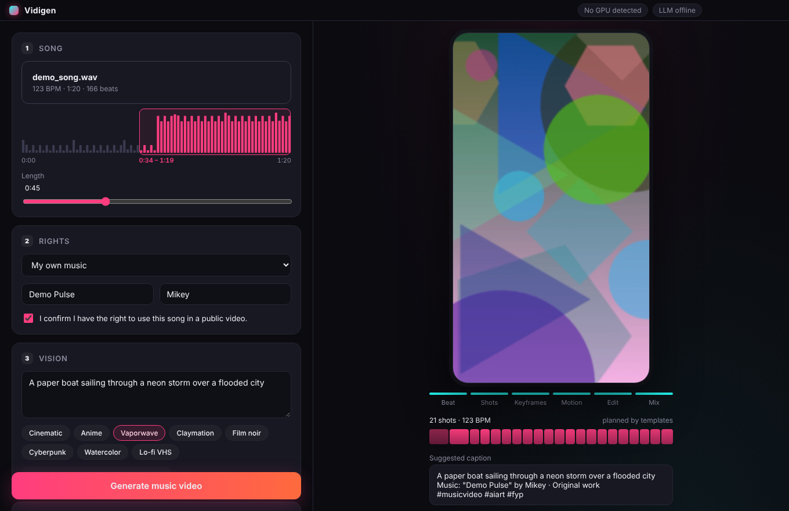

# Vidigen

A Windows desktop app that turns a prompt (plus, optionally, a song) into a 30–90 second vertical (9:16) music video for TikTok. It runs entirely on your own machine using local image, video and language models.



## How it works

Only the vision prompt is required. Without a song, cuts follow a beat grid at the tempo you choose and the video is exported silent, ready for a sound picked inside TikTok. Your own footage is optional too (video-to-video).

1. **Beat analysis.** The song is decoded with ffmpeg, then a numpy beat tracker (spectral-flux onsets, autocorrelation tempo, dynamic-programming beats) finds tempo, beats, downbeats and a loudness curve. By default the clip is the most energetic stretch of the song (usually the chorus or drop), starting on a downbeat.
2. **Shot planning.** Cuts land on beats: one bar per shot in loud sections, two bars in quiet ones. A local LLM via [Ollama](https://ollama.com) (default `qwen3:8b`) writes a prompt and camera move for each shot from your concept and style. Without Ollama it falls back to a template planner.
3. **Keyframes.** A text-to-image model renders one still per shot.
4. **Motion.** An image-to-video model animates each keyframe. If you add your own footage, each shot instead restyles the matching part of that clip (video-to-video).
5. **Edit and mix.** ffmpeg fits every clip to 1080×1920 at 30 fps and its exact beat-synced length, cuts them together, lays the song under it with fades, and writes a suggested caption that includes the song credit.

## Presets

| Preset | VRAM | Keyframes | Motion |
|---|---|---|---|
| mock | none | procedural art | ffmpeg pan/zoom |
| lite | 6 GB+ | SDXL-Turbo | ffmpeg pan/zoom |
| balanced | 12 GB+ | SDXL-Turbo | LTX-Video (distilled) |
| quality | 24 GB+ | FLUX.1-schnell | Wan 2.2 TI2V-5B |

The app picks the preset from the detected GPU (an RTX 5080 with 16 GB gets **balanced**). You can switch presets per render.

## Song rights

If you add a song, you can note its licence (your own work, CC0, public domain, CC BY / BY-SA, or a licence you hold) and the title and artist. That credit goes into the video metadata and the suggested caption. Vidigen can't check copyright for you and never blocks a render; CC BY songs just get a reminder to add the credit. Good sources: [Free Music Archive](https://freemusicarchive.org), [ccMixter](https://ccmixter.org), [Pixabay Music](https://pixabay.com/music/), [Musopen](https://musopen.org).

## Setup (Windows)

Requirements: Windows 10/11, Python 3.10+ (3.12 recommended), Node.js 22, ffmpeg, and an NVIDIA GPU for the AI presets.

Quick start: with Python installed, `cd app`, `npm install`, `npm run dev`. On first launch the app finds Python (skipping the Microsoft Store stub), creates its own environment and installs the engine, which is enough for the mock preset. For the AI presets, run the full setup:

```powershell
git clone https://github.com/michaelbudko/vidigen
cd vidigen
powershell -ExecutionPolicy Bypass -File .\setup.ps1
cd app
npm run dev
```

`setup.ps1` installs ffmpeg (winget) if needed, creates `engine\.venv` with CUDA 12.8 PyTorch (required for RTX 50-series cards), installs the engine, the Electron app, and Ollama with `qwen3:8b`. Use `-Mock` to skip the ML packages or `-NoLLM` to skip Ollama. Models download from Hugging Face on the first render and are cached.

## Command line

```powershell
cd engine
.\.venv\Scripts\python -m vidigen_engine system
.\.venv\Scripts\python -m vidigen_engine render song.mp3 "a paper boat in a neon storm" --style vaporwave --preset balanced --license own_work --duration 45
```

## Layout

```
app/       Electron + React + Vite desktop UI
  electron/  main process: starts the engine, file dialogs, media protocol
  src/       renderer UI
engine/    Python engine (FastAPI on 127.0.0.1, token-protected)
  vidigen_engine/
    audio.py      beat/tempo/energy analysis
    planner.py    beat-synced shot list, LLM or template prompts
    backends/     image (mock, diffusers) and video (pan/zoom, LTX-Video, Wan) generators
    compose.py    ffmpeg fit, cut and mix
    pipeline.py   render jobs
    server.py     local API for the UI
```

## Status

The full pipeline is tested end to end with the `mock` preset (procedural keyframes and pan/zoom). The diffusers backends (SDXL-Turbo, FLUX, LTX-Video, Wan) are written against the current diffusers APIs but still need a first run on a real GPU to tune steps, resolution and memory settings.

Next up: ComfyUI backend option, lyric/caption overlays, beat-synced transitions (flash, zoom punch), character consistency across shots (IP-Adapter), and a packaged Windows installer with a bundled Python runtime.
